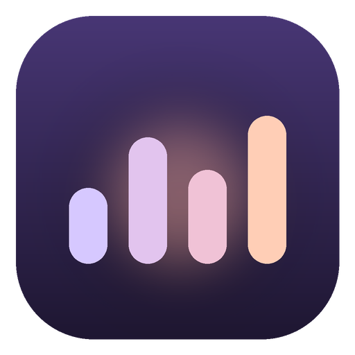

# Music Overlayer

**Made by ITX**

A small always-on-top now-playing overlay for Windows, with a built-in 10-band equalizer. It only follows music: Spotify, Deezer, TIDAL, Apple Music and other music apps, plus browser tabs (SoundCloud, YouTube Music, Deezer and Spotify Web). Discord, games and other apps are ignored.

## Install

Open **PowerShell** and run:

```powershell
irm https://raw.githubusercontent.com/itxxxx/Music-Overlayer/main/install.ps1 | iex
```

This installs Music Overlayer for your account (no admin needed), offers to set up the equalizer and starts the app. From version 1.2.0 on it updates itself (see [Updates](#updates)); running the same command again also updates it.

To uninstall, go to Windows Settings → Apps → Installed apps → Music Overlayer.

Music Overlayer needs 64-bit Windows 10 or 11.

## What's new in 1.3.0

- **No more music twice on screen share.** When you share your screen on Discord with the music-only equalizer on (or the volume above 100%), viewers used to hear your music twice. Now they hear it once, equalized, just like you. There's nothing to turn on. See [Troubleshooting](#troubleshooting).
- **Name your presets.** Saving your own equalizer settings now asks for a name, and you can rename a saved preset by double-clicking it.
- **New volume slider.** It grows under the pointer, stretches when you pull past either end, and shows the level while you hover or drag. It still goes up to 200%.
- **Smoother equalizer curve.** The line behind the bands now runs smoothly through every slider, so bands at the same level make a straight line.
- **Lighter.** About a quarter less memory (two fewer background processes), and less CPU while music plays: bands left at 0 dB no longer cost anything, and the bars wake the PC half as often.

## What's new in 1.2.0

- **Volume up to 200%.** The volume slider now goes past 100% to boost quiet songs and quiet players. It uses the same one-time VB-CABLE setup as the music-only equalizer. See [Volume above 100%](#volume-above-100).
- **Stays on your browser between songs.** When SoundCloud, YouTube Music or another tab moves on to the next song, the overlay stays on it instead of jumping back to Spotify. It only switches when you start another player.
- **Fixes itself if it gets stuck.** If the overlay ever stops responding, or can't be dragged or clicked, it now recovers on its own. There's also a new **Restart Music Overlayer** in the tray menu.
- **Lighter.** The open card uses much less CPU while music plays, and the tray menu shows how much CPU and memory the overlay uses in total.
- **Updates itself.** New versions download in the background; click **Restart to update** at the bottom of the card or in the tray menu. Coming from 1.1, run the install command once more to get 1.2.0, and it updates itself from then on.

## What's new in 1.1.0

- **Music-only equalizer.** The equalizer can now change just the player the overlay shows. Discord, games and everything else sound exactly as before. It's the new default, and the old behaviour is still there as **Everything**. See [The equalizer](#the-equalizer).
- **Volume slider.** Change the player's own volume right from the card.
- **More reliable covers.** Artwork shows up more often, and an optional online lookup finds covers that some players don't share.
- **Clearer shuffle and repeat.** The buttons light up when they're on, and repeat one shows a small 1.
- **Lighter on your PC.** The overlay uses less CPU and memory.

To update, run the install command again.

## What it does

- **Pill:** shows the artwork, title, artist and live bars. After 4 seconds on its own it fades to 75% opacity.
- **Card:** move the pointer over the pill and it comes back to full opacity. Rest there for 0.3 s and it opens into the card, with the cover art, a timeline you can drag to seek, previous/play-pause/next, and shuffle/repeat when the player supports them. Shuffle and repeat light up when they're on; repeat one shows a small 1.
- **Volume:** the slider under the controls changes the player's own volume, not your whole PC's. Up to 100% it's the same level as the player's slider in the Windows volume mixer; past 100% it boosts the player, up to 200%. For a browser tab it changes the whole browser, because Windows has no volume per tab.
- **Which player:** the overlay follows the player you started last, and stays on it through pauses and song changes until you start another one. To pick another player yourself, click the player name on the cover.
- **Equalizer:** 10 bands, presets, your own named presets and a preamp. By default it changes only the music player the overlay shows. Open it with the sliders button on the cover.
- **Colours:** the overlay picks its colours from the current album art.
- **Always on top:** it stays above other windows without taking focus. Clicks pass through everywhere except the overlay itself.

| To do this | Do this |
| --- | --- |
| Open the card | Rest the pointer on the pill for 0.3 s, or click it |
| Seek | Click or drag the timeline |
| Change the player's volume | Drag the volume slider, or scroll over it. Hover over it to see the level. Past the notch in the middle it boosts the player up to 200%. Click the speaker on the left to mute. |
| Switch player | Click the player name on the cover. It only works when more than one player is open. |
| Move the overlay | Drag it. The position is remembered. |
| Settings, hide, quit | Right-click the overlay, or use the tray icon |
| Update | When a new version is ready, click **Restart to update** at the bottom of the card. The tray menu also has **Check for updates**. |
| See how much CPU and memory it uses | Open the tray menu: the line under the name is the total for everything Music Overlayer runs |

## Music only

Music Overlayer shows music apps and browser tabs. Discord, games, Teams and every other app are ignored.

To change this, open the tray menu → **Players**:
- Tick or untick any player it has seen.
- Turn **Show browser tabs** off if you only want desktop music apps. Browser tabs are on by default because SoundCloud and YouTube Music play there.

The visualizer only moves while music is playing, so game sounds and voice chat don't drive it.

## The equalizer

The equalizer has two modes. Pick one at the top of the equalizer panel.

**Music only** (the default) changes only the player the overlay shows: Spotify, Deezer, a browser tab and so on. Discord, games and everything else sound exactly as before.

Windows can't equalize one app by itself, so this mode sends the player's sound through **VB-CABLE**, a free virtual audio cable by VB-Audio. Music Overlayer equalizes it there and plays it on your speakers or headphones. To set it up:

1. Open the equalizer in the card and click **Set up**, or say yes when the install command asks.
2. Allow it when Windows asks for permission, then allow the driver.
3. Restart Windows once.

Some things to know:
- For a browser tab, the whole browser goes through the equalizer, because Windows treats the browser as one app.
- The music gets a small delay, about the time it takes to blink. You won't notice it in music; a video may look very slightly out of sync.
- When Music Overlayer is closed, or the music stays paused for 20 seconds, the player goes back to playing straight to your speakers, without the equalizer.
- While the equalizer works, the Windows volume mixer shows the player at 1% (or 5%). That's on purpose: the player itself plays very quietly and Music Overlayer turns it back up to the volume you chose, so a screen share only gets the music once. Use the overlay's volume slider as usual; if you change the player's volume in the Windows mixer, Music Overlayer turns it back down. The player gets its own volume back when the equalizer stops.
- While the equalizer works, Windows shows Music Overlayer as using a microphone. That's VB-CABLE's recording side, which carries your music. Nothing is recorded or saved.

**Everything** changes all the sound on your speakers or headphones, including voices in Discord calls and games. It uses **Equalizer APO** (free, open source), which the panel offers to set up the same way. Then:
- To change which devices get it, use tray → **Equalizer engine** → **Choose speakers and headphones…**
- If you already use Equalizer APO, your own settings stay as they are; Music Overlayer only adds its own. To remove them, use tray → **Equalizer engine** → **Unlink Music Overlayer**.

Use the switch at the top of the equalizer panel to turn the equalizer off.

To keep your own settings, move the bands until **Custom** shows below them, click **Save**, type a name and press Enter. To rename a saved preset, double-click it. To delete it, click its ×.

## Volume above 100%

Drag the volume slider past the notch in the middle, or scroll up over it, to make the player louder than its own maximum, up to 200%. The part of the slider above 100% turns orange.

- It needs VB-CABLE, set up once from the equalizer panel (see [The equalizer](#the-equalizer)). Without it, the slider stops at 100%. It works with the equalizer in either mode, or switched off.
- Each player keeps its own boost, and it's remembered next time.
- A limiter keeps the loudest parts from crackling. At 200%, very loud songs can sound a little squashed.
- For a browser tab the whole browser is boosted, because Windows treats the browser as one app.
- Near 100% the slider snaps to 100%, which turns the boost off.
- When Music Overlayer is closed, or the music stays paused for 20 seconds, the player plays at its normal volume again. The boost comes back when it plays.

## Updates

Music Overlayer checks for a new version a little after it starts, then every few hours. When there is one, it downloads it in the background, and the bottom of the card shows **Restart to update to …**. Click it, or use the same item in the tray menu, and the overlay restarts on the new version within a few seconds. If you don't, the update installs the next time you quit Music Overlayer.

To check right away, use tray → **Check for updates**.

The portable version can't replace itself. When a new version is out, the card shows **Get version …**, which opens the download page.

## Troubleshooting

**People watching my screen share hear the music twice.**
When you share your whole screen, Discord records the sound of each program on its own: the player's own sound, which goes into VB-CABLE, and the overlay's equalized copy a moment later. Since 1.3.0 the player itself plays almost silently while the equalizer works, and the overlay turns it back up, so the copy Discord takes from the player is too quiet to hear. Update to 1.3.0 or later.

How quiet depends on VB-CABLE's quality setting. At 24 bit the player plays at 1% and viewers can't hear it at all. At 16 bit, which some computers use by default, it plays at 5% so the music keeps its quality, and a sharp ear may still catch a faint echo. To use 24 bit:
1. Press Win+R and run `mmsys.cpl`.
2. On **Playback**, open **CABLE Input** → **Properties** → **Advanced** and choose **24 bit, 48000 Hz**.
3. On **Recording**, do the same for **CABLE Output**.

Music Overlayer notices the change within a few seconds.

**The overlay is stuck: it can't be dragged and the buttons do nothing.**
It should recover by itself, within a minute at most. If it doesn't, use tray → **Restart Music Overlayer**. If it keeps happening, the log at `%APPDATA%\Music Overlayer\logs\main.log` shows what went on; attach it when you report the problem.

**The overlay switches to another player by itself.**
It switches when another player starts playing. Click the player name on the cover to go back; it then stays on that player until you start a different one.

**The overlay says "Can't read Windows media right now".**
The message under it gives the reason. It usually means a security policy or antivirus on this PC is blocking PowerShell scripts.

**A player doesn't show up.**
Tray → **Players** lists every app that reported media. Tick it there. In Firefox, also check that `media.hardwaremediakeys.enabled` is `true` in `about:config`.

**The timeline is greyed out, or shuffle and repeat are missing.**
That player doesn't let other apps use them. Browsers and Apple Music don't offer shuffle or repeat to other apps, so the card leaves those buttons out. SoundCloud and YouTube Music have them on their own page, but a browser can't pass them on to Windows.

**There's no cover art.**
Some players don't share their artwork with Windows. Tray → **Find missing covers online** looks it up by title and artist on Apple's iTunes Search. It's off until you turn it on.

**Music only says "Windows blocks apps from using recording devices".**
VB-CABLE's recording side counts as a microphone. In Windows Settings → Privacy → Microphone, turn on **Let desktop apps access your microphone**.

**A player is silent or very quiet.**
If Music Overlayer was closed unexpectedly while the equalizer worked, the player may still be sending its sound to VB-CABLE, or still be turned down to 1% in the Windows volume mixer. Start Music Overlayer again and it puts both back. You can also turn the player up in the volume mixer yourself, or reset it in Windows Settings → System → Sound → Volume mixer → **Reset**.

**There's no volume slider.**
The slider only shows when the player appears in the Windows volume mixer. Play something in it and it shows up.

**Task Manager lists Music Overlayer several times.**
Like every app built on Chromium, it runs as a few small processes, and Windows only groups them under one entry for apps with a taskbar button. The overlay deliberately has none. The tray menu shows the total for all of them, including its PowerShell helper (listed as "Windows PowerShell").

**The volume slider stops at 100%.**
Going higher needs VB-CABLE. Open the equalizer and click **Set up**, then restart Windows. Hover over the slider to see what's missing.

**The equalizer does nothing.**
- Restart Windows after setup.
- In **Music only**, the panel says which player it's equalizing. If the music plays without it, pause and play once.
- In **Everything**, check tray → **Equalizer engine** → **Choose speakers and headphones…** and make sure the device you listen on is ticked.

---

Music Overlayer is made by ITX.